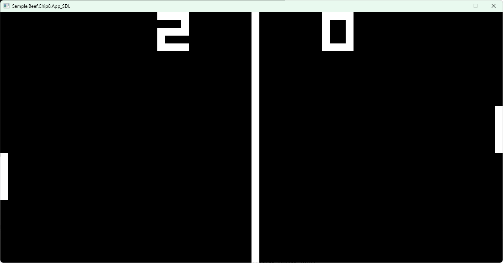

# Sample.Beef.Chip8

Sample [CHIP-8](https://en.wikipedia.org/wiki/CHIP-8) Emulator

- [beeflang](https://www.beeflang.org/)
- libs
  - [/SedulousWorks/SDL3-Beef](https://github.com/SedulousWorks/SDL3-Beef)
  - [Starpelly/raylib-beef](https://github.com/Starpelly/raylib-beef/)

